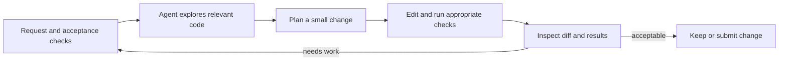

# A human-directed coding workflow

An **AI coding agent** is an [agent](agents.md) used to understand and change
software. It combines a [large language model](large-language-models.md) with
a codebase: the project's source files, configuration, documentation, and
other materials. The agent can use tools to read or edit files, run commands
(instructions that ask the computer to perform an operation), or inspect test
results.
Its ability to act comes from the surrounding [agent control loop and tool use](agent-control-loops-and-tool-use.md),
which should constrain what it can access and do. The agent proposes and
performs work within those boundaries; the person directing it remains
responsible for deciding whether the change is wanted and ready to keep.

## Give it a bounded task

Describe the problem, the intended behavior, useful context, and a visible
condition for completion. For example: “In the greeting function, change the
default name to `friend`. Keep the function's current interface. Add or update
a test showing the default behavior of the function (a named block of code
that performs a task), run the relevant tests, and summarize the
files changed.” A [requirement and acceptance condition](../software-engineering/requirements-engineering-and-acceptance.md)
turns “done” into something that can be checked. Official coding-agent
guidance likewise recommends a clear, well-scoped task and complete acceptance
criteria.[^github-copilot-task-guidance]

Start with a small, low-risk change while learning a tool. Ask the agent to
explain an unfamiliar file or propose a plan before editing when that will help
you understand the work. Supply only the context that is relevant and avoid
sharing secrets or private data. If the task is ambiguous or consequential,
clarify it or work through the design yourself before asking an agent to make
changes.

## Inspect evidence before keeping the change

Treat the agent's summary as a claim to verify. Read the changed files and the
complete [diff](../software-engineering/version-control-and-small-reversible-changes.md),
compare behavior with the request, and inspect test output. Tests are useful
evidence when they exercise the required behavior; they do not prove every
aspect of correctness. Use the project's [test strategy](../software-engineering/automated-testing-and-test-strategy.md)
and [code review](../software-engineering/code-review.md) practices to check
important edge cases, unintended edits, and maintainability. Agent-generated
changes require the same careful human review as other contributions, and
automated checks do not replace that review.[^github-review-copilot-output]

Before granting access to files, commands, or external services, understand
what those permissions allow. The [actions, policies, and permissions](../foundations/actions-policies-and-permissions.md)
concept explains why a request or generated tool argument alone does not grant
authority. Keep changes focused and reversible, and use [secure software development](../software-engineering/secure-software-development.md) practices
when code touches credentials, user data, authentication, or other sensitive
boundaries. Preserve useful records of the task, changes, and checks as
[information provenance](../information-systems/information-provenance-and-trust.md)
when later readers need to understand what happened.

An [agent](agents.md) is the general goal-directed system; this concept
applies that model to software changes. It complements [agent control loops and tool use](agent-control-loops-and-tool-use.md) with the task, diff, and
verification practices specific to coding.

[^github-copilot-task-guidance]: GitHub, [Best practices for using GitHub Copilot to work on tasks](https://docs.github.com/en/copilot/using-github-copilot/using-copilot-coding-agent-to-work-on-tasks/best-practices-for-using-copilot-to-work-on-tasks).
[^github-review-copilot-output]: GitHub, [Review output from Copilot](https://docs.github.com/en/copilot/how-tos/copilot-on-github/use-copilot-agents/review-copilot-output).
